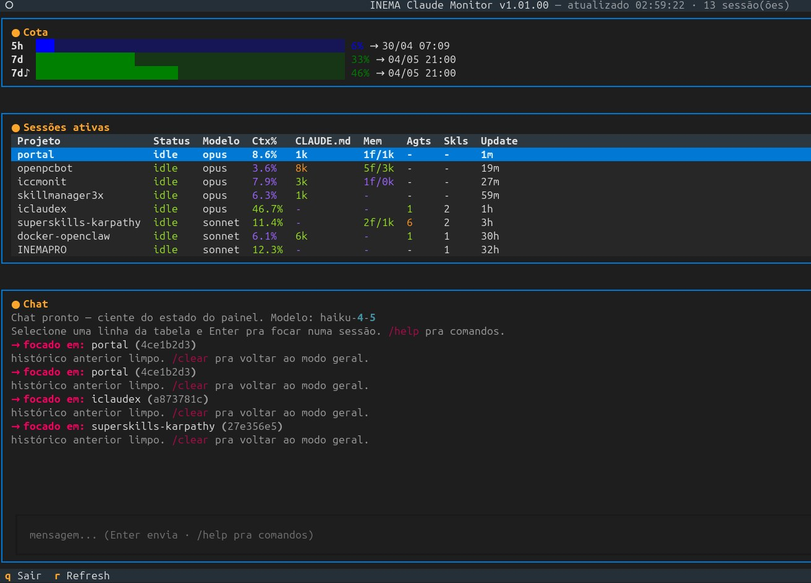

# iccmonit ê¢â‚¬â€ ARCKHÉ Claude Monitor

TUI em Python que monitora **todas as sessêƒÂµes Claude Code ativas** na mêƒÂ¡quina em tempo real, com cota 5h/7d, mêƒÂ©tricas por sessêƒÂ£o e chat embutido via OAuth.

Pensado para rodar em um **terminal separado** ao lado das suas sessêƒÂµes Claude Code, dando visêƒÂ£o consolidada de:

- SessêƒÂµes ativas (busy / idle), modelo em uso, % do contexto consumido
- Cota da API: janela de 5 horas, semanal global e semanal Sonnet (separada)
- Tamanho do `CLAUDE.md`, da memêƒÂ³ria do projeto, agentes lanêƒÂ§ados e skills invocadas
- Chat com Claude (Haiku por padrêƒÂ£o) ciente do estado do painel

VersêƒÂ£o atual: **v1.17.11**



---

## SumêƒÂ¡rio

- [Requisitos](#requisitos)
- [InstalaêƒÂ§êƒÂ£o](#instalaêƒÂ§êƒÂ£o)
- [Uso](#uso)
  - [Modo terminal](#modo-terminal)
  - [Modo web](#modo-web)
  - [Atalhos](#atalhos-de-teclado)
- [PainêƒÂ©is da TUI](#painêƒÂ©is-da-tui)
- [Fontes de dados](#fontes-de-dados)
- [ConfiguraêƒÂ§êƒÂ£o](#configuraêƒÂ§êƒÂ£o--configjson)
- [Arquitetura](#arquitetura)
- [Versionamento](#versionamento)
- [Roadmap](#roadmap)
- [SoluêƒÂ§êƒÂ£o de problemas](#soluêƒÂ§êƒÂ£o-de-problemas)
- [Por que nêƒÂ£o usar X?](#por-que-nêƒÂ£o-usar-x)
- [LicenêƒÂ§a](#licenêƒÂ§a)

---

## Requisitos

- **Python 3.10+**
- **Claude Code instalado e logado** (precisa de `~/.claude/.credentials.json` vêƒÂ¡lido)
- **Statusline padrêƒÂ£o do Claude Code rodando** ê¢â‚¬â€ êƒÂ© ele que popula `/tmp/cc_limits_<uid>.json` com a cota oficial da API. Sem isso o painel de cota fica vazio.
- Sistema operacional **Linux** ou **macOS** (testado no Linux). O `tac` êƒÂ© usado para ler transcripts de trêƒÂ¡s pra frente ê¢â‚¬â€ em macOS tem o equivalente.

## InstalaêƒÂ§êƒÂ£o

```bash
git clone git@github.com:linnoff88-dev/iccmonit.git
cd iccmonit
chmod +x start.sh
```

DependêƒÂªncias (instaladas automaticamente pelo `start.sh` se faltarem):

```bash
pip install textual anthropic --break-system-packages           # modo terminal
pip install textual-serve --break-system-packages               # modo web (extra)
```

## Uso

### Modo terminal

```bash
./start.sh
```

Abre a TUI no terminal atual. Ideal para rodar lado-a-lado com as sessêƒÂµes Claude Code.

### Modo web

```bash
./start.sh web                       # 127.0.0.1:8000     ê¢â‚¬â€ apenas local (padrêƒÂ£o)
./start.sh web 9000                  # 127.0.0.1:9000     ê¢â‚¬â€ porta custom
./start.sh web 8000 lan              # <ip-da-LAN>:8000   ê¢â‚¬â€ outras mêƒÂ¡quinas da rede
./start.sh web 8000 192.168.1.50     # IP especêƒÂ­fico
```

Usa o pacote **`textual-serve`** para empacotar a TUI atual num WebSocket + xterm.js no navegador, sem mudanêƒÂ§a de cêƒÂ³digo. O servidor (`serve.py`) abre o navegador automaticamente.

**Modos de bind:**

| Modo | Bind | Quem acessa |
|------|------|-------------|
| padrêƒÂ£o | `127.0.0.1` | SêƒÂ³ o prêƒÂ³prio host |
| `lan`  | IP da LAN auto-detectado (rota pro `8.8.8.8`) | Qualquer mêƒÂ¡quina na sub-rede |
| `<ip>` | IP fornecido | Quem rotear atêƒÂ© esse IP |

> ê¢Å¡Â  **Sem autenticaêƒÂ§êƒÂ£o.** No modo `lan`, qualquer um na rede com o IP+porta acessa o monitor ê¢â‚¬â€ incluindo o chat OAuth conectado êƒÂ  sua conta. Use sêƒÂ³ em rede de confianêƒÂ§a. Pra acesso atravêƒÂ©s da internet, prefira **SSH tunnel** em vez de expor a porta:
>
> ```bash
> ssh -L 8000:localhost:8000 usuario@maquina
> ```
>
> Bindar em `0.0.0.0` estêƒÂ¡ **bloqueado** porque o `textual-serve` embute o host de bind no websocket e o navegador rejeita conexêƒÂ£o WS pra `0.0.0.0`. êƒÅ¡til pra:

- Acompanhar de outra mêƒÂ¡quina na rede local (acesse `http://<ip-da-maquina>:8000`)
- Manter o monitor visêƒÂ­vel num browser sem ocupar terminal
- Compartilhar visêƒÂ£o temporêƒÂ¡ria com colegas na mesma rede

### Ajuda

```bash
./start.sh -h    # mostra os modos disponêƒÂ­veis
```

### Atalhos de teclado

| Tecla | AêƒÂ§êƒÂ£o |
|-------|------|
| `r`   | Refresh manual |
| `a`   | Alterna entre **SessêƒÂµes ativas** ê¢â€ â€ **todas** (vivas + mortas) |
| `p`   | Liga/desliga o painel **Processos** (top N da mêƒÂ¡quina) |
| `v`   | Liga/desliga o painel **ServiêƒÂ§os** (Docker + systemd boot) |
| `s`   | Quando Processos visêƒÂ­vel: alterna ordenaêƒÂ§êƒÂ£o **CPU% ê¢â€ â€ RAM%** |
| `,`   | Encolhe a coluna esquerda em 5% (chat fica maior) |
| `.`   | Aumenta a coluna esquerda em 5% (chat fica menor) |
| `=`   | Reseta a divisêƒÂ£o em 50/50 |
| `1`   | Abre **Cota** em fullscreen modal |
| `2`   | Abre **MêƒÂ¡quina** em fullscreen |
| `3`   | Abre **Processos** em fullscreen |
| `4`   | Abre **SessêƒÂµes** em fullscreen |
| `5`   | Abre **ServiêƒÂ§os** em fullscreen (Docker completo + systemd boot completo) |
| **click** no têƒÂ­tulo de uma seêƒÂ§êƒÂ£o | Mesmo efeito do `1`-`4` correspondente |
| `Esc` ou `q` (no modal) | Fecha o modal |
| `q`   | Sair |

Auto-refresh a cada **10 segundos** por padrêƒÂ£o (configurêƒÂ¡vel em `config.json` via `refresh_interval_seconds`). A coleta (lêƒÂª transcripts grandes, roda `nvidia-smi`, `docker ps`, etc.) acontece numa **worker thread** ê¢â‚¬â€ a TUI nêƒÂ£o congela e os valores antigos ficam na tela atêƒÂ© o novo lote chegar. O subtitle do header mostra **"atualizado hêƒÂ¡ Xs"** ticando a cada segundo.

Chat tambêƒÂ©m êƒÂ© assêƒÂ­ncrono: ao enviar, a mensagem aparece na hora com `aguardando claude...` enquanto a API responde em background. Mandar nova mensagem antes da anterior chegar êƒÂ© bloqueado com aviso.

---

## PainêƒÂ©is da TUI

A TUI tem layout em duas colunas (50/50 por padrêƒÂ£o, redimensionêƒÂ¡vel com `,` `.` `=`):

- **Esquerda** ê¢â‚¬â€ empilha verticalmente: Cota ê¢â€ â€™ MêƒÂ¡quina ê¢â€ â€™ Processos (opcional) ê¢â€ â€™ SessêƒÂµes
- **Direita** ê¢â‚¬â€ Chat ocupando toda a altura

Limites de redimensionamento: 20% / 80%. NêƒÂ£o fica tudo de um lado sêƒÂ³.

### 1. Cota (topo)

Barra horizontal por janela:

| Linha | Significado |
|-------|-------------|
| `5h`  | Janela rolante de 5 horas ê¢â‚¬â€ todos os modelos |
| `7d`  | Janela semanal ê¢â‚¬â€ todos os modelos |
| `7dê¢â„¢Âª` | Janela semanal **Sonnet** ê¢â‚¬â€ limite separado, importante monitorar |

Cor da barra segue os thresholds de `quota_pct` em `config.json`. Se a barra aparecer "aguardando API..." êƒÂ© porque o cache `/tmp/cc_limits_<uid>.json` estêƒÂ¡ vazio ou velho (> 2 min).

### 2. MêƒÂ¡quina

Uso de hardware do servidor ê¢â‚¬â€ barras coloridas pelos thresholds de `system_pct`:

| Linha | Mostra |
|-------|--------|
| `CPU`  | `usage_pct` (load1 / cores) + load 1m/5m/15m + nꂺ de cores |
| `RAM`  | `used / total MB` + swap usado |
| `Disk` | `used / total GB` + livre |
| `GPU`  | `nvidia-smi`: utilizaêƒÂ§êƒÂ£o %, VRAM, temperatura. Linha some se nêƒÂ£o houver GPU NVIDIA. |

CPU usa `os.getloadavg()` (nêƒÂ£o `psutil`), RAM lêƒÂª `/proc/meminfo`, GPU êƒÂ© opcional via `nvidia-smi`. Sem dependêƒÂªncias extras.

### 3. Processos (opcional ê¢â‚¬â€ tecla `p`)

Top N processos da mêƒÂ¡quina, ordenados por **%CPU** ou **%RAM** (alterna com `s`). Default: oculto.

| Coluna | Mostra |
|--------|--------|
| `PID` | identificador do processo |
| `User` | dono (truncado em 10 chars) |
| `CPU%` | % de CPU (cor pelos thresholds de `system_pct`) |
| `RAM%` | % de RAM (mesma escala de cor) |
| `Tempo` | etime (`HH:MM:SS` ou `D-HH:MM:SS`) |
| `Comando` | comm truncado em 40 chars |

Coleta via `ps -eo pid,user,pcpu,pmem,etime,comm --sort=-%cpu` (sem dependêƒÂªncia extra). êƒÅ¡til pra:

- Saber **quais sessêƒÂµes `claude` estêƒÂ£o consumindo CPU/RAM** (cada PID aparece separado)
- Detectar processos pesados quando o painel MêƒÂ¡quina ficar ê°Å¸Å¸Â¡/ê°Å¸â€Â´
- Ver `ollama`, GPU workers, dev servers etc. na mesma tela

ConfigurêƒÂ¡vel: `top_processes_n` no `config.json` (padrêƒÂ£o `10`). O painel sêƒÂ³ polla `ps` quando estêƒÂ¡ visêƒÂ­vel ê¢â‚¬â€ nêƒÂ£o tem custo quando oculto.

### 4. ServiêƒÂ§os (opcional ê¢â‚¬â€ tecla `v`)

Resumo de **Docker** e **systemd boot** num painel sêƒÂ³. Default: oculto.

**Inline mostra sêƒÂ³ o que importa:**

```
Docker   10/44 containers ativos
  ê¢Å““ imkt4-postgres-1     Up 4 days     0.0.0.0:5432->5432/tcp
  ê¢Å““ openclaw-ollama      Up 4 days     0.0.0.0:11434->11434/tcp
  ê¢Å““ open-webui           Up 4 days     0.0.0.0:3000->8080/tcp
  ... +7 ativos ê‚· use 5 pra ver tudo (incl. parados)
Boot     33/102 systemd .service habilitados rodando  (abra modal pra ver lista)
```

**Modal (`5`)** mostra a lista completa: todos os containers (incluindo parados, com cêƒÂ³digo de saêƒÂ­da) e todas as services systemd habilitadas com estado atual (`running`, `dead`, `exited`, `failed`).

Coleta:
- Docker via `docker ps -a` ê¢â‚¬â€ se `docker` nêƒÂ£o estiver no `$PATH`, mostra "indisponêƒÂ­vel"
- Boot via 2 chamadas a `systemctl` (1êƒâ€” `list-unit-files --state=enabled`, 1êƒâ€” `list-units --all` para o estado) ê¢â‚¬â€ sem polling unitêƒÂ¡rio, leve
- SêƒÂ³ roda quando o painel estêƒÂ¡ visêƒÂ­vel (zero custo quando oculto)

### 5. SessêƒÂµes (ativas ou todas)

Tabela com uma linha por sessêƒÂ£o Claude Code. Por padrêƒÂ£o mostra sêƒÂ³ sessêƒÂµes com PID alive; pressione **`a`** para incluir as mortas (sessêƒÂµes cujo arquivo em `~/.claude/sessions/*.json` ainda existe mas o processo terminou). Mortas aparecem em cinza com status `morta`. Colunas:

| Coluna | DescriêƒÂ§êƒÂ£o |
|--------|-----------|
| **Projeto** | Nome do diretêƒÂ³rio de trabalho (truncado em 20 chars) |
| **Status** | `idle` (verde) ou `busy` (amarelo) |
| **Modelo** | `opus`, `sonnet`, `haiku` ou outro |
| **Ctx%** | % da janela de 1M tokens em uso. Soma `input + cache_read + cache_creation + output` |
| **CLAUDE.md** | Tamanho do `CLAUDE.md` no `cwd` da sessêƒÂ£o |
| **Mem** | `<n>f/<x>k` ê¢â‚¬â€ nêƒÂºmero de arquivos e KB totais em `memory/` |
| **Agts** | Quantidade de chamadas êƒÂ  tool `Agent` no transcript |
| **Skls** | Skills distintas invocadas (tool `Skill`) |
| **Update** | Tempo desde o êƒÂºltimo update (`12s`, `3m`, `1h`) |

Cada mêƒÂ©trica recebe cor azul/verde/amarelo/vermelho conforme thresholds em `config.json`.

### 6. Chat (lateral)

Chat embutido com Claude com **dois modos**:

**Modo geral** (padrêƒÂ£o) ê¢â‚¬â€ recebe o estado completo do painel como system prompt:

- "Qual sessêƒÂ£o têƒÂ¡ usando mais contexto?"
- "Quanto falta pra cota Sonnet?"
- "Algum projeto com memêƒÂ³ria crêƒÂ­tica?"

**Modo focado** ê¢â‚¬â€ selecione uma linha da tabela (ê¢â€ â€˜/ê¢â€ â€œ + **Enter**) e o chat carrega o transcript daquela sessêƒÂ£o como contexto. AêƒÂ­ dêƒÂ¡ pra perguntar sobre o trabalho especêƒÂ­fico:

- "O que essa sessêƒÂ£o têƒÂ¡ fazendo agora?"
- "Qual foi o êƒÂºltimo erro?"
- "Resume o que foi feito atêƒÂ© agora."
- "Por que ele tomou essa decisêƒÂ£o?"

> O chat êƒÂ© um **observador analêƒÂ­tico** ê¢â‚¬â€ nêƒÂ£o interage com o agente daquela sessêƒÂ£o, sêƒÂ³ lêƒÂª o transcript. Pra interaêƒÂ§êƒÂ£o remota real, ver V2 no roadmap.

#### Comandos do chat

| Comando | AêƒÂ§êƒÂ£o |
|---------|------|
| `/help`   | Ajuda completa (TUI + chat + skills + roadmap) |
| `/diag`   | DiagnêƒÂ³stico do painel ê¢â‚¬â€ lista cota e sessêƒÂµes em alerta (ê°Å¸Å¸Â¡/ê°Å¸â€Â´) com sugestêƒÂµes |
| `/skills` | 3 skills êƒÂºteis pra rodar nas sessêƒÂµes focadas (statusline / memory-audit / handoff) |
| `/clear`  | Volta ao modo geral (limpa o foco e o histêƒÂ³rico) |
| `/log`    | Mostra as êƒÂºltimas 20 linhas do log de chat |
| `/where`  | Imprime os caminhos do log, config e diretêƒÂ³rio de projects |
| `/docker` | sem args: lista containers rodando ê‚· `/docker <nome> start\|stop\|restart\|logs` age direto |
| `/fork`   | *(roadmap V2)* ê¢â‚¬â€ abrir nova sessêƒÂ£o Claude Code continuando a focada |

Trocar de foco tambêƒÂ©m limpa o histêƒÂ³rico do chat ê¢â‚¬â€ pra nêƒÂ£o misturar conversas.

#### DiagnêƒÂ³stico do painel ê¢â‚¬â€ `/diag`

Roda regras locais sobre os thresholds do `config.json` e devolve sêƒÂ³ o que estêƒÂ¡ em **ê°Å¸Å¸Â¡ yellow** ou **ê°Å¸â€Â´ red**:

- Cotas (5h, 7d, 7d Sonnet) em alerta
- SessêƒÂµes com `Ctx%` alto (risco de auto-compaction)
- SessêƒÂµes com memêƒÂ³ria ou `CLAUDE.md` inchados
- SessêƒÂµes com muitos agentes lanêƒÂ§ados

Quando algo aparece, sugere a skill apropriada do `skillmanager3x` (`session-handoff`, `memory-audit`, etc).

#### Skills êƒÂºteis ê¢â‚¬â€ `/skills`

Lista as 3 skills do [skillmanager3x](https://github.com/linnoff88-dev/skillmanager3x) com **quando usar cada uma**:

| Skill | Quando rodar |
|-------|--------------|
| **session-statusline** | Checkpoint operacional rêƒÂ¡pido durante o trabalho. Triggers: "onde estamos", "checkpoint", "organiza a sessêƒÂ£o". |
| **memory-audit**       | Quando o painel mostra memêƒÂ³ria ê°Å¸Å¸Â¡/ê°Å¸â€Â´ ou CLAUDE.md grande. Triggers: "analise a memêƒÂ³ria", "memêƒÂ³ria inchada", "limpa memêƒÂ³ria". |
| **session-handoff**    | Antes de `/clear` ou quando ctx ê°Å¸â€Â´. Gera resumo pra um agente fresco continuar. Triggers: "vou dar /clear", "handoff", "encerrar sessêƒÂ£o". |

Como rodar: na sessêƒÂ£o Claude Code alvo, digite o trigger ou `/<skill-name>`.

#### Log de chat

Cada turno (vocêƒÂª ê¢â€ â€™ claude) e cada erro sêƒÂ£o gravados em `chat.log` no diretêƒÂ³rio do projeto. Inclui:

- timestamp, role (user/claude), foco (`[geral]` ou `[focus=<8 chars>]`), e texto
- em caso de erro: status code e body cru da resposta da API

êƒÅ¡til pra debugar 401 (OAuth expirado/invêƒÂ¡lido), rate limit, payload invêƒÂ¡lido, etc. O arquivo estêƒÂ¡ no `.gitignore`.

Modelo padrêƒÂ£o: `claude-haiku-4-5-20251001` (configurêƒÂ¡vel em `config.json` ê¢â€ â€™ `chat.model`). AutenticaêƒÂ§êƒÂ£o via OAuth do Claude Code (token em `~/.claude/.credentials.json`).

---

## Fontes de dados

| MêƒÂ©trica | Fonte |
|---|---|
| SessêƒÂµes ativas | `~/.claude/sessions/*.json` ê¢â‚¬â€ um arquivo por PID, filtrado por processo vivo (`os.kill(pid, 0)`) |
| Modelo, contexto %, custo | êƒÅ¡ltima mensagem `assistant` com `usage` no transcript JSONL **ativo** em `~/.claude/projects/<encoded-cwd>/`. O `sessionId` em `session.json` congela no boot ê¢â‚¬â€ apêƒÂ³s `/clear` o Claude Code cria um JSONL novo e o monitor segue o de `mtime` mais recente |
| Cota 5h / 7d / 7d-Sonnet | `/tmp/cc_limits_<uid>.json` ê¢â‚¬â€ cache do statusline (fonte oficial via API Anthropic) |
| `CLAUDE.md` | `stat` do arquivo em `<cwd>/CLAUDE.md` |
| MemêƒÂ³ria | Conta arquivos e soma bytes de `~/.claude/projects/<encoded-cwd>/memory/` |
| Agentes lanêƒÂ§ados | Tool uses `name == "Agent"` no transcript (acumulado na sessêƒÂ£o) |
| Skills invocadas | Tool uses `name == "Skill"` no transcript (distintas) |
| Chat OAuth | `~/.claude/.credentials.json` ê¢â€ â€™ `claudeAiOauth.accessToken`. Header: `anthropic-beta: oauth-2025-04-20` |

> A cota **nêƒÂ£o** êƒÂ© recalculada localmente como `ccm`/`ccusage` fazem ê¢â‚¬â€ êƒÂ© lida do cache que o prêƒÂ³prio Claude Code mantêƒÂ©m com os valores oficiais da API. Isso evita divergêƒÂªncia.

### Encoding do `cwd`

Barras e dois pontos viram hêƒÂ­fens, com hêƒÂ­fen prefixado:

```
/home/user/projetos/foo  ê¢â€ â€™  -home-user-projetos-foo
```

O monitor tenta ambas as variaêƒÂ§êƒÂµes (com e sem hêƒÂ­fen prefixado) ao localizar transcript e diretêƒÂ³rio de memêƒÂ³ria.

---

## ConfiguraêƒÂ§êƒÂ£o ê¢â‚¬â€ `config.json`

EditêƒÂ¡vel sem tocar no cêƒÂ³digo. Estrutura:

### `thresholds`

Limites de cor por mêƒÂ©trica. Cada mêƒÂ©trica tem 4 nêƒÂ­veis: `blue` ê¢â€°Â¤ `green` ê¢â€°Â¤ `yellow` ê¢â€°Â¤ `red`.

| MêƒÂ©trica | O que mede | Defaults (b/g/y/r) |
|---------|------------|--------------------|
| `quota_pct`           | % da cota usada (5h, 7d, 7d-Sonnet) | 20 / 60 / 85 / 95 |
| `context_pct`         | % da janela de contexto da sessêƒÂ£o. >90% = risco de auto-compaction | 10 / 50 / 75 / 90 |
| `memory_kb`           | Tamanho total da memêƒÂ³ria do projeto (KB). >600 = considere `/memory-audit` | 0 / 100 / 300 / 600 |
| `memory_files`        | NêƒÂºmero de arquivos de memêƒÂ³ria. >35 = fragmentaêƒÂ§êƒÂ£o | 0 / 10 / 20 / 35 |
| `claude_md_bytes`     | Tamanho do `CLAUDE.md`. >40KB = pode impactar contexto | 0 / 8192 / 20480 / 40960 |
| `agents_per_session`  | Agentes lanêƒÂ§ados na sessêƒÂ£o. >30 = sessêƒÂ£o muito pesada | 0 / 5 / 15 / 30 |
| `cost_per_session_usd`| Custo acumulado em USD. >$20 = revisar eficiêƒÂªncia | 0 / 2 / 8 / 20 |

Esquema visual:

| Cor | Significado |
|-----|-------------|
| ê°Å¸â€Âµ Azul | Muito baixo / ocioso |
| ê°Å¸Å¸Â¢ Verde | Normal / saudêƒÂ¡vel |
| ê°Å¸Å¸Â¡ Amarelo | AtenêƒÂ§êƒÂ£o |
| ê°Å¸â€Â´ Vermelho | CrêƒÂ­tico / alerta |

### `alerts`

Habilita/desabilita mensagens de alerta individualmente:

| Chave | PadrêƒÂ£o | Mensagem |
|-------|--------|----------|
| `quota_5h_red`  | enabled  | ê¢Å¡Â  Cota 5h crêƒÂ­tica! |
| `quota_7d_red`  | enabled  | ê¢Å¡Â  Cota semanal crêƒÂ­tica! |
| `context_red`   | enabled  | ê¢Å¡Â  Contexto alto ê¢â‚¬â€ risco de compaction |
| `memory_red`    | enabled  | ê¢Å¡Â  MemêƒÂ³ria excessiva ê¢â‚¬â€ rode `/memory-audit` |
| `claude_md_red` | disabled | ê¢Å¡Â  CLAUDE.md muito grande |
| `cost_red`      | enabled  | ê¢Å¡Â  SessêƒÂ£o cara |

### `chat`

| Campo | PadrêƒÂ£o | DescriêƒÂ§êƒÂ£o |
|-------|--------|-----------|
| `model`      | `claude-haiku-4-5-20251001` | Modelo do chat embutido |
| `max_tokens` | `1024` | Tamanho mêƒÂ¡ximo da resposta |

### Outros

| Campo | PadrêƒÂ£o | DescriêƒÂ§êƒÂ£o |
|-------|--------|-----------|
| `title` | `ARCKHÉ Claude Monitor` | TêƒÂ­tulo do header (a versêƒÂ£o êƒÂ© appendada automaticamente) |
| `refresh_interval_seconds` | `10` | Intervalo de auto-refresh em segundos |

---

## Arquitetura

```
iccmonit/
ê¢â€Å“ê¢â€â‚¬ê¢â€â‚¬ monitor.py     # TUI principal (Textual) ê¢â‚¬â€ V1
ê¢â€Å“ê¢â€â‚¬ê¢â€â‚¬ serve.py       # Wrapper de modo web via textual-serve
ê¢â€Å“ê¢â€â‚¬ê¢â€â‚¬ start.sh       # Entrypoint: terminal e modo web
ê¢â€Å“ê¢â€â‚¬ê¢â€â‚¬ config.json    # Thresholds, alertas, chat, refresh
ê¢â€Å“ê¢â€â‚¬ê¢â€â‚¬ README.md      # Este arquivo
ê¢â€Å“ê¢â€â‚¬ê¢â€â‚¬ CLAUDE.md      # InstruêƒÂ§êƒÂµes do projeto pra Claude Code
ê¢â€Å“ê¢â€â‚¬ê¢â€â‚¬ .gitignore
ê¢â€â€ê¢â€â‚¬ê¢â€â‚¬ docs/
    ê¢â€Å“ê¢â€â‚¬ê¢â€â‚¬ img/         # Screenshots
    ê¢â€Å“ê¢â€â‚¬ê¢â€â‚¬ PLAN.md      # Plano original e decisêƒÂµes de arquitetura
    ê¢â€â€ê¢â€â‚¬ê¢â€â‚¬ RESEARCH.md  # Pesquisa das fontes de dados do Claude Code
```

### Componentes do `monitor.py`

| SêƒÂ­mbolo | Papel |
|---------|-------|
| `load_sessions()` | LêƒÂª `~/.claude/sessions/*.json` e filtra por PID vivo |
| `get_transcript_usage()` | LêƒÂª êƒÂºltima `assistant.usage` do transcript via `tac` |
| `get_session_extras()` | Calcula tamanho de `CLAUDE.md`, memêƒÂ³ria, contagem de agentes/skills |
| `load_quota()` | LêƒÂª `/tmp/cc_limits_<uid>.json` (descarta se > 120s) |
| `get_oauth_token()` | Extrai `accessToken` do `.credentials.json` |
| `QuotaBar` | Widget com barras de cota |
| `SessionTable` | DataTable com sessêƒÂµes |
| `ChatPane` | RichLog + Input ê¢â‚¬â€ chat com `system` montado a cada mensagem com snapshot do painel |
| `MonitorApp` | App Textual; auto-refresh via `set_interval` |

---

## Versionamento

Constante `VERSION` em `monitor.py` no formato **`v1.xx.yy`**:

- **major (`1`)** ê¢â‚¬â€ sêƒÂ³ muda na transiêƒÂ§êƒÂ£o para V2
- **`xx`** ê¢â‚¬â€ incrementa a cada **recurso novo** (sequencial: `01`, `02`, ...)
- **`yy`** ê¢â‚¬â€ incrementa a cada **bug fix** (sequencial dentro da major)
- **`yy` NêƒÆ’O reinicia** quando `xx` sobe ê¢â‚¬â€ sêƒÂ³ zera junto com `xx` na transiêƒÂ§êƒÂ£o de major

Exemplos:
- `v1.00.00` ê¢â€ â€™ estado inicial
- `v1.01.00` ê¢â€ â€™ primeiro recurso novo (nenhum bug fix ainda)
- `v1.01.02` ê¢â€ â€™ apêƒÂ³s dois bugs fixados dentro do recurso `01`
- `v1.02.02` ê¢â€ â€™ prêƒÂ³ximo recurso (`yy` mantêƒÂ©m em `02` porque nenhum novo bug foi corrigido)
- `v1.02.03` ê¢â€ â€™ bug fix sobre `v1.02.02`
- `v2.00.00` ê¢â€ â€™ mudanêƒÂ§a de major zera tudo

A versêƒÂ£o êƒÂ© exibida no têƒÂ­tulo da janela TUI (header).

---

## Roadmap

- **V1** *(atual)* ê¢â‚¬â€ painel de sessêƒÂµes + cota + chat geral + chat focado em sessêƒÂ£o (read-only) + modo web
- **V2** *(planejado)* ê¢â‚¬â€ interaêƒÂ§êƒÂ£o remota com sessêƒÂ£o ativa: injetar prompts numa sessêƒÂ£o como se estivesse no terminal original. Mecanismo a investigar:
  - stdin do processo Claude Code
  - arquivo de IPC
  - ou `claude --resume <sessionId>` num processo paralelo (forka, nêƒÂ£o dirige a sessêƒÂ£o original)
  - sem API oficial ê¢â‚¬â€ requer pesquisa

---

## SoluêƒÂ§êƒÂ£o de problemas

| Sintoma | Causa provêƒÂ¡vel | Como resolver |
|---------|----------------|---------------|
| Cota mostra `aguardando API...` | `/tmp/cc_limits_<uid>.json` ausente ou > 2 min | Confirme que o statusline padrêƒÂ£o do Claude Code estêƒÂ¡ rodando ê¢â‚¬â€ ele popula esse cache |
| Chat indisponêƒÂ­vel | Token OAuth nêƒÂ£o encontrado | FaêƒÂ§a login novamente no Claude Code e confirme que `~/.claude/.credentials.json` tem `claudeAiOauth.accessToken` |
| Chat retorna `401` | Token OAuth expirado, revogado, ou cota da janela esgotada | Use `/log` no chat pra ver o body do erro. Se expirado, faêƒÂ§a `claude logout` + `claude login`. Se cota, espere a janela renovar (vide painel de cota). |
| Tabela vazia | Nenhuma sessêƒÂ£o Claude Code ativa | Abra uma sessêƒÂ£o `claude` em outro terminal e dêƒÂª `r` para refresh |
| `Ctx%` zerado | Transcript ainda sem mensagem `assistant` com `usage` | Use a sessêƒÂ£o um pouco ê¢â‚¬â€ depois da primeira resposta o valor aparece |
| Modo web nêƒÂ£o abre | Porta ocupada | Tente outra porta: `./start.sh web 9001` |
| Modo web abre o "demo" do Textual | VersêƒÂ£o antiga sem `textual-serve` | Atualize: `git pull` (a partir de v1.01.01 usa `textual-serve` separado) |
| Modo web mostra sêƒÂ³ o logo "iccmonit" e nêƒÂ£o carrega a TUI | VersêƒÂ£o `v1.01.01` bindando em `0.0.0.0` (websocket invêƒÂ¡lido no navegador) | Atualize pra `v1.01.02`+ ê¢â‚¬â€ bind virou `127.0.0.1` |
| ApêƒÂ³s `/clear` o `Ctx%` continua alto | VersêƒÂ£o ê¢â€°Â¤ `v1.02.00` lia o JSONL antigo (sessionId congelado em `session.json`) | Atualize pra `v1.02.01`+ ê¢â‚¬â€ passa a seguir o JSONL mais recente (`mtime`) |
| Erro `ImportError: textual` | DependêƒÂªncias nêƒÂ£o instaladas | Rode `pip install textual anthropic --break-system-packages` ou simplesmente `./start.sh` (instala automaticamente) |

---

## Por que nêƒÂ£o usar X?

- **`ccm` / claude-monitor** ê¢â‚¬â€ calcula cota a partir dos JSONL locais e diverge da cota real da API. Aqui usamos o cache oficial.
- **`ccusage`** ê¢â‚¬â€ ferramenta de auditoria/relatêƒÂ³rio, nêƒÂ£o tempo real.
- **`claude-pulse`** ê¢â‚¬â€ o `statusline-command.sh` existente jêƒÂ¡ cobre o mesmo escopo.

---

## LicenêƒÂ§a

MIT.

---

Projeto  - ARCKHÉe